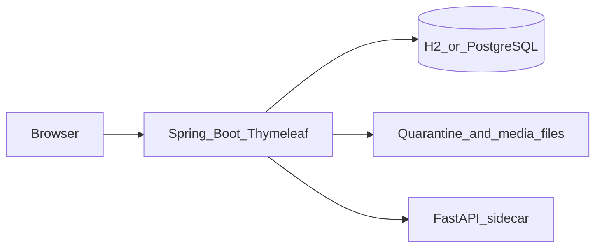

# SchoolChan

SchoolChan is an anonymous discussion board for St. Joseph's Academy of Las Piñas Senior High School. Students post without accounts. Staff are the only people who sign in. The board stays up as an archive: threads are not deleted just because they went quiet.

It is a local-first capstone. The board runs on a laptop with an embedded database. Paid APIs are not required. Large moderation models are optional.

**Run it:** [docs/LOCAL.md](docs/LOCAL.md)

From the `schoolchan` folder, two terminals:

```powershell
.\scripts\run-ml.ps1
.\scripts\run-backend.ps1
```

- Board: http://localhost:8080
- Staff: http://localhost:8080/staff/login (`admin` / `change-me-now`)

Change the staff password with `SCHOOLCHAN_ADMIN_PASSWORD` before a real demo.

## Purpose

Students need a place to talk about campus life without a social-media account, and the school needs a way to keep that place within the rules. SchoolChan does both:

- Anyone on the school network can read and, during open hours, post.
- Posts are screened before they appear. Clear violations are blocked. Uncertain posts wait for a person. Posts that look like a safety risk go to a staff-only escalation queue.
- Poster IP addresses and session identifiers are stored encrypted and are not shown on the board. A staff member can reveal them only for a stated reason, and that access is written to an audit log.
- Nothing in this app contacts authorities by itself. Escalation produces a package a person can print or download.

## Who uses it

| Person | Account | What they can do |
| --- | --- | --- |
| Student or visitor | None | Read boards, post and reply during open hours, vote, report, reveal spoilers, request an English view of a post |
| Staff | Username and password | Review held posts, publish or block, edit hours and rules, approve learned keywords, open escalation packages |

There are no public profiles, no poster IDs, and no student registration.

## Features

**Board.** Home lists boards (General, Academics, Events) and a rotating quote. A thread can be bumped by a reply, left in place with sage, or pushed into a read-only archive when the board is full or the bump limit is reached. Greentext and `>>` quote links are rendered in the page. Spoilers stay collapsed until the reader opens them.

**Hours.** Writes follow access windows in Asia/Manila. The seeded window is weekdays 07:00–22:00. Outside that window the board is read-only by default. Staff can edit or disable a window, add one, or switch closed hours to fully unavailable.

**Moderation.** Each new post passes a pipeline: keyword and blacklist, link checks, optional text classification, optional translation of Tagalog or Cebuano into English, and an image check when a file is attached. Scores plus the poster’s reputation decide publish, hold for review, block, or escalate. If the moderation sidecar is down, text posts are held for a person instead of published on an empty score.

**Media.** Uploads are checked by file signature, quarantined, and stripped of JPEG EXIF and IPTC segments before anyone can see them. Blocked files are removed. A perceptual-hash blocklist can stop a known image from being posted again.

**Reputation.** A session is a salted hash, not a name. Confirming a report raises that session’s reliability. Rejecting one lowers it. A confirmed block can add a short strike and propose a learned keyword. That keyword is not enforced until staff approve it. Votes do not change moderation.

**Staff tools.** Review queue, settings, escalation cases (original text, English when present, timestamps, print-to-PDF, text download), and an audit log. The downloaded package does not include the poster IP.

**Evaluation.** A sample fixture can be scored into accuracy, a McNemar comparison of keyword-only versus hybrid detection, and fixture latency. See [docs/EVALUATION.md](docs/EVALUATION.md).

## Architecture

The browser talks to one Java server. Pages are server-rendered. A small Python service is optional and only scores text, images, and translation.



| Piece | Role |
| --- | --- |
| Spring Boot 3, Java 21 | Boards, access hours, moderation decisions, staff login, audit |
| Thymeleaf | HTML pages. Scripts and styles are served by the app, not a CDN |
| H2 file database | Default local store (`backend/data/`). No separate database process |
| PostgreSQL 16 | Optional, via Docker, when you want the same engine as a later server |
| FastAPI sidecar, port 8090 | Mock scores by default. Real path loads ToxiScan for text and NLLB for translation |
| Local disk | Quarantined and released uploads |

A post is saved as pending, screened, then published, held, blocked, or escalated. Published media is released from quarantine only after that decision. Threads move from active, to sinking once they pass the bump limit, to archived when the board’s active-thread cap evicts them. Archived threads stay readable.

Package map and the data model are in [docs/ARCHITECTURE.md](docs/ARCHITECTURE.md). Locked choices (timezone, closed-hours mode, fail-safe when models are down) are in [docs/DECISIONS.md](docs/DECISIONS.md).

## Privacy and safety

- Public pages do not include IP addresses, session tokens, or staff names.
- IP and session material are AES-GCM encrypted and revealed only from an escalation page, with a reason, into the audit log.
- Ordinary logs do not record post bodies or raw IP addresses.
- Seed and demo triggers use `TOKEN_*` placeholders. Do not commit real harmful text or explicit images.
- Rules on `/rules` state acceptable use, that moderation is automatic and human, and that a genuine safety case may include the post and the poster IP.

Design notes for the Data Privacy Act are in [docs/PRIVACY.md](docs/PRIVACY.md). Header and auth notes are in [docs/SECURITY.md](docs/SECURITY.md).

## Run locally

`run-backend.ps1` is the light path: embedded H2, no Docker. `run-ml.ps1` is mock moderation and does not download models.

| Script | What it does |
| --- | --- |
| `scripts/run-backend.ps1` | Board on port 8080, profile `local` |
| `scripts/run-ml.ps1` | Mock sidecar on port 8090 |
| `scripts/run-ml-real.ps1` | ToxiScan and NLLB. First start downloads weights. Images stay mocked until `IMAGE_MODEL_ID` is a local ONNX file |
| `scripts/run-eval.ps1` | Writes `accuracy.json`, `mcnemar.json`, and `latency.md` under `eval/results/`, then exits |

Docker Postgres is the heavier option and is documented as secondary in [docs/LOCAL.md](docs/LOCAL.md). A click-through demo is in [docs/DEMO.md](docs/DEMO.md).

Java 21 is required. A portable JDK may already be at `../tools/jdk-21`. Python 3.11+ is required for the sidecar.

## Tests

```powershell
cd backend
.\gradlew.bat test

cd ..\ml-service
python -m pytest -q
```

If Gradle reports that a class file is “not a regular file,” OneDrive has locked `backend\build`. Delete that folder and run the tests again. The exact commands are in the local guide.

## Further reading

- [Run locally](docs/LOCAL.md)
- [Architecture](docs/ARCHITECTURE.md) · [Plan](docs/PLAN.md) · [Decisions](docs/DECISIONS.md)
- [Privacy](docs/PRIVACY.md) · [API](docs/API.md) · [Evaluation](docs/EVALUATION.md)
- [Demo](docs/DEMO.md) · [Security](docs/SECURITY.md)

## Models and license

NLLB translation weights are CC-BY-NC, which is acceptable for this academic local use. The default scripts do not download them. ToxiScan is the text model used when you start `run-ml-real.ps1`.
