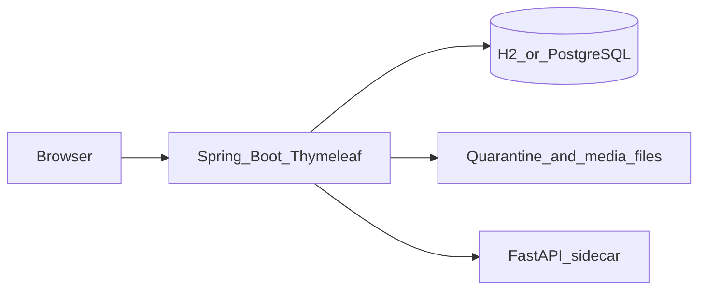

# SchoolChan

SchoolChan is an anonymous discussion board for St. Joseph's Academy of Las Piñas Senior High School. Students post without accounts. Staff are the only people who sign in. The board stays up as an archive: threads are not deleted just because they went quiet.

It is a local-first capstone. The board runs on a laptop with an embedded database. Paid APIs are not required. Large moderation models are optional.

**Run it:** [docs/LOCAL.md](docs/LOCAL.md)

### One click (Windows)

Double-click **`start-schoolchan.bat`** in this folder. It starts the moderation
sidecar and the web app, prints the URLs, and keeps the window open.
**Close that window to stop SchoolChan.**

- Board: http://localhost:8080
- Staff: http://localhost:8080/staff/login (`admin` / `change-me-now`)

`stop-schoolchan.bat` force-stops any leftover instance.

### Manual (two terminals)

```powershell
.\scripts\run-ml.ps1
.\scripts\run-backend.ps1
```

### On a phone (same Wi-Fi)

The app listens on every interface, so a phone on the same network can open it.
**Staff → Dashboard → "Open it on a phone"** shows the exact address to type
(for example `http://192.168.100.11:8080`).

The board is built for small screens: the composer becomes a bottom sheet, the
thread nav wraps, and the floating ▲/▼ buttons sit above the keyboard area.

If the phone cannot connect, check that the firewall allows port 8080 and that
the phone is on the same network rather than mobile data.

### The real moderation models (optional)

The default path uses a mock so nothing is downloaded. To run the real models:

```powershell
.\scripts\setup-real-models.ps1   # once: creates a Python 3.11/3.12 venv
.\scripts\run-ml-real.ps1         # downloads the weights on first use
```

| Model | Role | Size | Licence |
| --- | --- | --- | --- |
| `vectorsense/toxiscan` | English toxicity / hate / threat / self-harm | ~136 MB | Apache-2.0 |
| `onnx-community/nsfw_image_detection-ONNX` | OpenNSFW2 image classifier | ~90 MB | check the repo |
| `facebook/nllb-200-distilled-600M` | Tagalog / Cebuano → English | ~2.5 GB | CC-BY-NC |

Both ONNX models run on the CPU through `onnxruntime` — **PyTorch is not required**.
Verify them yourself:

```powershell
cd ml-service
.\.venv-real\Scripts\python.exe scripts\verify_models.py
.\.venv-real\Scripts\python.exe scripts\smoke_real_models.py
```

- Board: http://localhost:8080
- Staff: http://localhost:8080/staff/login (`admin` / `change-me-now`)

Change the staff password with `SCHOOLCHAN_ADMIN_PASSWORD` before a real demo.

## Purpose

Students need a place to talk about campus life without a social-media account, and the school needs a way to keep that place within the rules. SchoolChan does both:

- Anyone on the school network can read and, during open hours, post.
- Posts are published straight away. A filter, another student, or a moderator may **point a post out** to the staff team, and it then waits in the staff review queue where a person decides. A machine never removes a post on its own, and the person who wrote it is not told about the flag. Posts that look like a safety risk are hidden and go to a staff-only escalation queue.
- Poster IP addresses and session identifiers are stored encrypted and are not shown on the board. A staff member can reveal them only for a stated reason, and that access is written to an audit log.
- Nothing in this app contacts authorities by itself. Escalation produces a package a person can print or download.

## Who uses it

| Person | Account | What they can do |
| --- | --- | --- |
| Student or visitor | None | Read boards, post and reply during open hours, vote, report, reveal spoilers, request an English view of a post |
| Signed-in student | Student ID number + password | Everything above, plus **My posts** and **Bookmarks**, and onboarding a newly enrolled classmate for staff to approve |
| Staff | Username and password | Review flagged posts, leave them up or remove them, edit hours and rules, approve learned keywords, provision student accounts, open escalation packages |

### Student sign-in (on by default)

Only provisioned students and staff can act on the board. A signed-out visitor can
still read, but posting, replying, voting, reporting and bookmarking all go to the
sign-in page first.

- **Staff → Students** — provision accounts, disable/enable, reset passwords
- **/student/enroll** — a signed-in student submits a new classmate's ID; staff approve it
- **Staff → Settings → Student access** — turn the gate off, or also close reading
- **Demo accounts** — `2024-10001`, `2024-10002`, `2023-10003` (password `student123`)

The account is a **gate only** — it is never attached to a post. Posts stay labelled
"Anonymous" and use the anonymous session hash, so the board keeps its anonymity even
with the gate on. See `docs/DECISIONS.md` ADR-012.

A staff account and a student account are never active in the same browser: signing in
as one signs out the other.

### Your data

The board lives in an H2 file database at `backend/data/schoolchan.mv.db`. It is **not**
deleted when you restart. To keep a copy, run **`backup-db.bat`** (or
`scripts\backup-db.ps1`) — copies land in `backend/data/backups/`.

There are no public profiles, no poster IDs, and no student registration.

## Features

**About page** at `/about` — a plain-language introduction to what SchoolChan is, how posting works, how moderation works, and what is stored.

**Board.** Home lists the boards (General, Academics, Events, Random, Tech, Sports, Music, Arts, Lunch, Advice, Announcements) and a rotating quote. A thread can be bumped by a reply, left in place with sage, or pushed into a read-only archive when the board is full or the bump limit is reached. Greentext and `>>` quote links are rendered in the page, and each quoted post lists the replies that answered it (`→ 124, 130`). Spoilers stay collapsed until the reader opens them. The board list supports **endless scroll** (toggleable), a **catalog grid** with thumbnails, and hover previews. A thread card shows a small picture when the thread has one — whether it was on the opening post or in a reply — and it is always the small copy, so a page never downloads a full-size photo. Times read as "12 min ago" with the exact time on hover. **Filters** (next to the board links) hide, collapse or highlight threads by a word in the subject or opening post, and the **×** on a thread card hides it for you; both are stored only in this browser, with a "N hidden — show" bar to get them back. The **catalog** can be sorted by bump, newest, most replies or most images, filtered to threads with pictures, and shows two lines of the opening post under each card.

**Reading and replying.** Threads open in a 4chan-style view: numbered posts, images you can click to enlarge, per-post inline reply boxes, votes, reports, and a reply box at the bottom. A long thread shows its opening post and the newest 60 replies, with "N replies omitted — show all" (`?all=true`); a link to an omitted post opens the full thread by itself. Each post has a `#` permalink and a short `/boards/general/p/149` link, and posting lands you on the post you just made. Your own posts carry a quiet `You` chip. Pictures load lazily at their real size; "Expand images" / "Shrink images" is remembered per browser, and the lightbox steps through the thread's pictures with ← / →. Keyboard shortcuts: `j`/`k` move between posts, `r` replies, `b` goes back to the board, `t`/`e` jump to the top or bottom. Unread posts are highlighted. The author can edit a post for 10 minutes; edits are re-screened. Spoilers can be revealed one at a time or all at once, and a media blur toggle hides images until you click them. **While you read**, the thread checks for new replies every 25 seconds and shows "N new posts — show"; nothing is inserted until you click it, and polling pauses while the tab is hidden or a reply box has text in it. Staff can turn polling off or change the interval from Staff → Settings.

**Themes.** The board is light by default. The header button switches to **dark** mode, and only when you click it — the operating system setting is ignored so the page never changes appearance on you. Your choice is remembered.

**Personal views.** **Bookmarks** and **My posts** are tied to your anonymous browser session, so you can always find what you saved. They appear once you have signed in as a student; a signed-out visitor is sent to the sign-in page instead, because they cannot post and the lists would be empty. If a moderator later removes one of your posts, **My posts** shows it as removed — you can still read it there, and ask a moderator to look again. The **Quoted you** tab lists replies that quoted one of your post numbers, newest first, with a link back to the thread. You can delete your own post for 15 minutes after posting it.

**Hours.** Writes follow access windows in Asia/Manila. The seeded window is weekdays 07:00–22:00. Outside that window the board is read-only by default. Staff can edit or disable a window, add one, or switch closed hours to fully unavailable.

**Moderation.** Each new post passes a pipeline: keyword and blacklist, link checks, optional text classification, optional translation of Tagalog or Cebuano into English, and an image check when a file is attached. The scores plus the poster’s reputation decide whether a post is **published plainly** or **published and pointed out to the staff team**. A flagged post stays up, and the person who wrote it is not told — only staff see the flag. A person, never a model, decides whether a post comes down. If the moderation sidecar is down, posts are still published; the dashboard says the model could not check them. The one exception is the escalation category: a post that reads as a genuine safety risk is hidden and routed to the restricted escalation queue. See [ADR-014](docs/DECISIONS.md).

**Media.** Uploads are checked by file signature, quarantined, and stripped of JPEG EXIF and IPTC segments before anyone can see them. Blocked files are removed. A perceptual-hash blocklist can stop a known image from being posted again. Every picture is scaled down to a sensible size when it arrives (a 4 MB phone photo becomes a few hundred kilobytes) and a small copy is kept for the board previews. A nightly job shrinks anything still too large, makes the missing preview copies, and deletes files no post points at any more. **Staff → Settings → Storage** shows how much disk is in use and runs either job on demand.

**Reputation.** A session is a salted hash, not a name. Confirming a report raises that session’s reliability. Rejecting one lowers it. A confirmed block can add a short strike and propose a learned keyword. That keyword is not enforced until staff approve it. Votes do not change moderation.

**Staff tools.** Review queue that shows the **whole post** — the text as written, the English translation, the board and thread it came from with a link to it, and any attachment (opened behind a disclosure, since a moderator cannot judge what they cannot read). Filter by hidden/flagged/reported and reason, with an age indicator, or switch to **"Every screened post"** to see everything the pipeline decided. Plus a **blacklist manager** with CSV import/export and a **test-a-string** tool that shows exactly how the normaliser sees the text, settings, escalation cases (original text, English when present, timestamps, print-to-PDF, text download), staff notes, and an audit log. **Escalation rehearsal mode** lets staff rehearse the safety pathway without exposing real post data. When the moderation service is unreachable, the dashboard says so, so nobody mistakes a service outage for a wave of bad posts. Staff browsing the public board gets a staff ribbon and inline moderation controls. The downloaded package does not include the poster IP.

**Evaluation.** A sample fixture can be scored into accuracy, a McNemar comparison of keyword-only versus hybrid detection, and fixture latency. See [docs/EVALUATION.md](docs/EVALUATION.md).

## Architecture

The browser talks to one Java server. Pages are server-rendered. A small Python service is optional and only scores text, images, and translation.



| Piece | Role |
| --- | --- |
| Spring Boot 3, Java 21 | Boards, access hours, moderation decisions, staff login, audit |
| Thymeleaf | HTML pages. Scripts and styles are served by the app, not a CDN |
| H2 file database | Default local store (`backend/data/`). No separate database process |
| PostgreSQL 16 | Optional, via Docker, when you want the same engine as a later server |
| FastAPI sidecar, port 8090 | Mock scores by default. Real path loads ToxiScan for text and NLLB for translation |
| Local disk | Quarantined and released uploads |

A post is saved as pending, screened, then published (plainly, or published and flagged for a person to review). A post that reads as a genuine safety risk is hidden and escalated instead. A machine never removes a post. Published media is released from quarantine only after that decision. Threads move from active, to sinking once they pass the bump limit, to archived when the board’s active-thread cap evicts them. Archived threads stay readable.

Package map and the data model are in [docs/ARCHITECTURE.md](docs/ARCHITECTURE.md). Locked choices (timezone, closed-hours mode, fail-safe when models are down) are in [docs/DECISIONS.md](docs/DECISIONS.md).

## Privacy and safety

- Public pages do not include IP addresses, session tokens, or staff names.
- IP and session material are AES-GCM encrypted and revealed only from an escalation page, with a reason, into the audit log.
- Ordinary logs do not record post bodies or raw IP addresses.
- Seed and demo triggers use `TOKEN_*` placeholders. Do not commit real harmful text or explicit images.
- Rules on `/rules` state acceptable use, that moderation is automatic and human, that a machine never removes a post, and that a genuine safety case may include the post and the poster IP.

Design notes for the Data Privacy Act are in [docs/PRIVACY.md](docs/PRIVACY.md). Header and auth notes are in [docs/SECURITY.md](docs/SECURITY.md).

## Run locally

`run-backend.ps1` is the light path: embedded H2, no Docker. `run-ml.ps1` is mock moderation and does not download models.

| Script | What it does |
| --- | --- |
| `scripts/run-backend.ps1` | Board on port 8080, profile `local` |
| `scripts/run-ml.ps1` | Mock sidecar on port 8090 |
| `scripts/run-ml-real.ps1` | ToxiScan and NLLB. First start downloads weights. Images stay mocked until `IMAGE_MODEL_ID` is a local ONNX file |
| `scripts/run-eval.ps1` | Writes `accuracy.json`, `mcnemar.json`, and `latency.md` under `eval/results/`, then exits |

Docker Postgres is the heavier option and is documented as secondary in [docs/LOCAL.md](docs/LOCAL.md). A click-through demo is in [docs/DEMO.md](docs/DEMO.md).

Java 21 is required. A portable JDK may already be at `../tools/jdk-21`. Python 3.11+ is required for the sidecar.

## Tests

```powershell
cd backend
.\gradlew.bat test

cd ..\ml-service
python -m pytest -q
```

If Gradle reports that a class file is “not a regular file,” OneDrive has locked `backend\build`. Delete that folder and run the tests again. The exact commands are in the local guide.

## Further reading

- [Run locally](docs/LOCAL.md)
- [Architecture](docs/ARCHITECTURE.md) · [Plan](docs/PLAN.md) · [Decisions](docs/DECISIONS.md)
- [Privacy](docs/PRIVACY.md) · [API](docs/API.md) · [Evaluation](docs/EVALUATION.md)
- [Demo](docs/DEMO.md) · [Security](docs/SECURITY.md)

## Models and license

NLLB translation weights are CC-BY-NC, which is acceptable for this academic local use. The default scripts do not download them. ToxiScan is the text model used when you start `run-ml-real.ps1`.

## GitHub upload: what to commit and what to skip

Commit the source and docs. The `.gitignore` already excludes generated and machine-specific files.

### Commit these
- `backend/src`, `backend/gradle/wrapper`, `backend/gradlew`, `backend/gradlew.bat`
- `ml-service/app`, `ml-service/tests`, `ml-service/requirements.txt`, `ml-service/Dockerfile`
- `docs/`, `scripts/`, `templates` (under `backend/src/main/resources`)
- `.env.example`, `docker-compose.yml`, `Makefile`, `AGENTS.md`, `README.md`

### Skip these
- `backend/build/`, `backend/.gradle/`
- `backend/data/` (H2 database and media; sample content is seeded on first run)
- `ml-service/.venv/`, `ml-service/.venv-real/`, `__pycache__/`, `.pytest_cache/`
- `eval/results/`
- `.env`, IDE files, cookies, and OS files

### Folder and file names needed to run after clone
| Dependency | Where it goes | What must be inside |
| --- | --- | --- |
| Java 21 | `tools/jdk-21/` (one folder above `schoolchan`) | `bin/java.exe` or `bin/java` |
| Gradle 8.10.2 (optional) | `tools/gradle-8.10.2/` | `bin/gradle` |
| Python environment | `ml-service/.venv/` or `ml-service/.venv-real/` | created by `setup-real-models.ps1` |
| Environment file | `schoolchan/.env` | copied from `schoolchan/.env.example` |
| Database | `backend/data/schoolchan.mv.db` | created on first run |
| Media files | `backend/data/media/` | created as uploads are screened and released |

<<<<<<< HEAD
If Java 21 is already installed and on `PATH`, the `tools/jdk-21` folder is optional.
=======
If Java 21 is already installed and on `PATH`, the `tools/jdk-21` folder is optional.
>>>>>>> d5851d3 (Initial commit)
