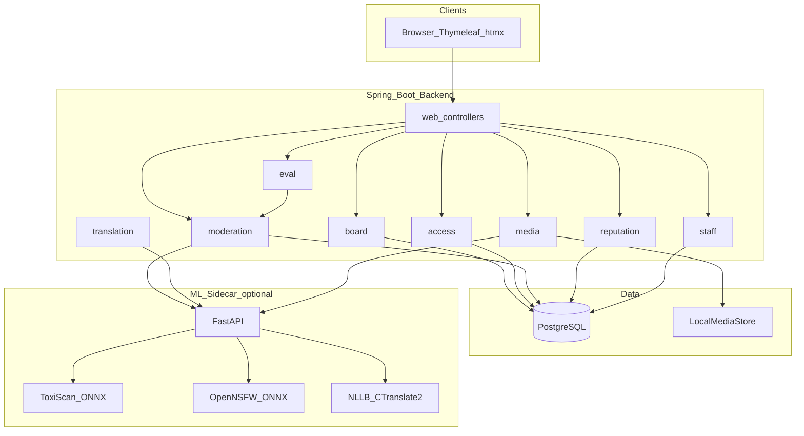
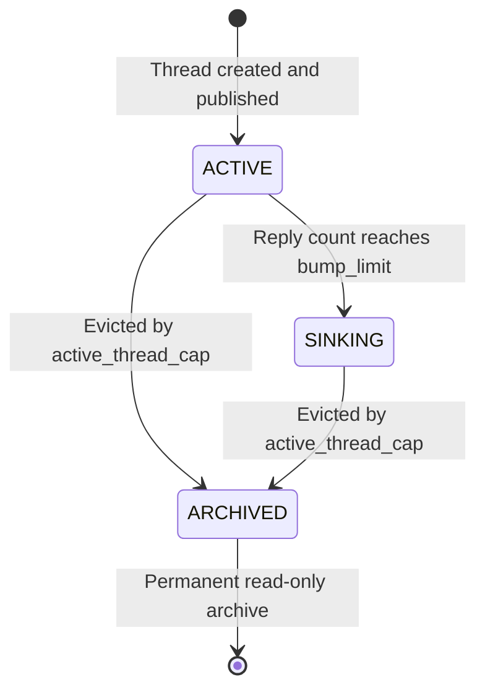
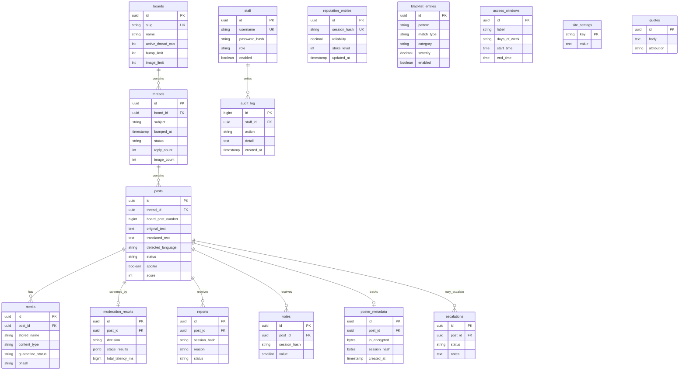

# SchoolChan Architecture

## 1. Component overview



## 2. Post lifecycle

```mermaid
sequenceDiagram
  participant U as User
  participant W as Web
  participant A as AccessFilter
  participant B as BoardService
  participant M as MediaStore
  participant P as Pipeline
  participant D as DecisionEngine
  participant DB as Postgres
  participant ML as ML_Sidecar

  U->>W: POST thread or reply
  W->>A: Check access window and rate limits
  alt Closed unavailable
    A-->>U: Closed page
  else Closed read_only
    A-->>U: 403 write blocked
  else Open
    W->>B: Create post PENDING_SCREENING
    B->>DB: Insert post and poster_metadata encrypted
    opt Has media
      B->>M: Store in quarantine
    end
    B->>P: Run stages
    P->>P: KeywordBlacklist
    P->>P: LinkScreening
    P->>ML: Text classify optional
    P->>ML: Translate optional
    opt Media present
      P->>ML: NSFW classify async path
    end
    P->>D: Combine scores and reputation
    alt ESCALATE
<<<<<<< HEAD
      D->>DB: HELD escalation queue
    else BLOCK
      D->>DB: BLOCKED delete media
    else QUEUE
      D->>DB: HELD_FOR_REVIEW
    else PUBLISH
      D->>DB: PUBLISHED bump or archive if cap
    end
    W-->>U: Result page or friendly block message
  end
```

=======
      D->>DB: Flagged, hidden, and added to the escalation queue
    else Flagged (filter, report, or moderator)
      D->>DB: PUBLISHED and flagged for the review queue
    else Clean
      D->>DB: PUBLISHED bump or archive if cap
    end
    W-->>U: Post page, with a note if it was flagged
  end
```

> **Policy note (ADR-014).** The board never removes a post on its own. `BLOCK` and
> `QUEUE_FOR_REVIEW` both mean "published and flagged" in normal use; only a person
> removes a post, from the staff review queue. The one exception is the escalation
> category, which is hidden and routed to the restricted escalation queue.

>>>>>>> d5851d3 (Initial commit)
## 3. Thread lifecycle state machine



- **ACTIVE**: replies bump `bumped_at` (unless sage).
- **SINKING**: past bump limit; replies allowed but do not bump.
- **ARCHIVED**: read-only; never deleted for inactivity; browsable under `/{board}/archive`.

## 4. Data model (ER)



## 5. Package map (backend)

| Package | Responsibility |
| --- | --- |
| `board` | Boards, threads, posts, bump, archive, votes |
| `access` | Access windows, closed-mode, admin override |
| `moderation` | Pipeline stages, decision engine, queues |
| `reputation` | Reports, reliability, similarity boost |
| `translation` | Java client to sidecar translation |
| `media` | Upload, quarantine, serve, phash |
| `staff` | Auth, roles, audit, retention jobs |
| `eval` | Benchmark harness, McNemar, latency |
| `web` | Controllers, Thymeleaf, static assets |

## 6. Security boundaries

- Public routes never emit IP, session token, or staff identity.
- `poster_metadata` is AES-GCM encrypted; decrypt only on explicit staff action with audit reason.
- Media served only after release from quarantine; blocked files deleted (hash retained).
- Staff routes under `/staff/**` with CSRF, BCrypt, rate-limited login.
